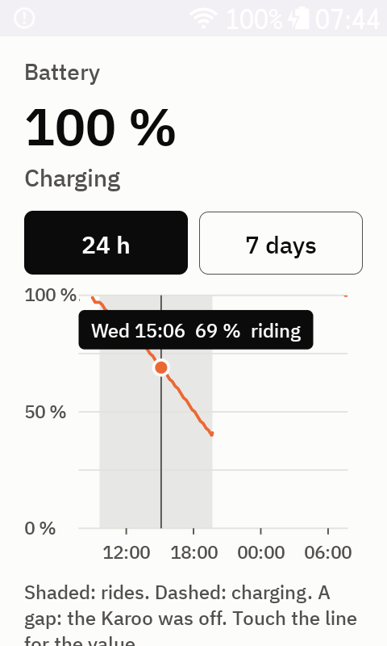
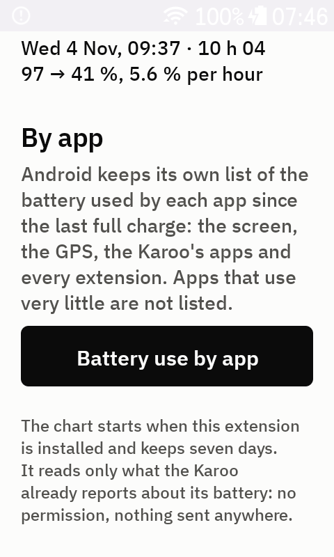

# BatteryUsage

The Karoo's battery at a glance, on the Hammerhead Karoo: how it went over the last 24 hours or 7 days with your rides on it, what each ride used per hour, and Android's own list of the battery used by each app, the screen, the GPS and every extension.

No permissions, no network, nothing to set up: install it and it starts recording.

## What you get

**The battery now.** The level in large type and, on battery, how fast it went down in the last hour ("5.4 % per hour").

**The chart**, over 24 hours or 7 days:

- the battery level as a line, dashed while charging;
- your rides as grey bands behind it;
- a gap where the Karoo was off;
- touch the line, or drag along it, for the time, the level and whether you were riding.

**Your rides.** The last five, each with its start, its length and what it used: "97 → 41 %, 5.6 % per hour". A ride during which the Karoo was charging says so instead of giving a number.

**By app.** The button **Battery use by app** opens Android's battery page; tap **Battery usage** there for Android's list since the last full charge, app by app: the ride app, the screen, the Karoo's location and sensor services, and every extension. Android leaves out the apps that use very little, so an extension that is not on the list uses next to nothing.

## Why it exists

Battery use is the first doubt about any extension. Android knows how much each app uses; BatteryUsage puts that list one tap away, next to a chart of what the battery really did on your rides, with no computer and no `adb`. It is the tool behind [the battery measurements of my extensions](https://lagorai.bike/blog/karoo-extensions-battery-use/).

## Install

1. Download `BatteryUsage.apk` from the latest release.
2. Sideload it onto the Karoo, for example from the Hammerhead companion app, or with `adb install -r BatteryUsage.apk`.
3. Open **BatteryUsage** from the Karoo's extensions. There is nothing to grant: the chart fills in by itself from now on.

Once installed it appears in the Karoo **Extensions** library with its description, screenshots and version, and the Karoo checks there for a newer release.

## How it works

The extension listens to the battery broadcast Android sends to every app whenever the level or the charger changes, and writes a line when something changed, plus one every 10 minutes when nothing did: so a gap of more than 25 minutes means the Karoo was off. The start and the end of each ride come from the Karoo's ride state. A ride cut by the Karoo switching off ends at the last line before the gap. Seven days are kept, in a small file of the app's private storage.

It does nothing else in the background: no polling of its own beyond the 10-minute line, no sensors, no network.

The list by app is Android's, not computed by BatteryUsage: Android does not let an app read the battery used by other apps, but any app may open the system page that shows it. Its numbers are Android's estimates, from the Karoo's power profile, and do not count the time on the charger.

## Privacy

No permissions, no network, no account. The battery history stays on the Karoo.

## Sibling extensions

- [BetterETA](https://github.com/anpaiss/BetterETA): arrival time that learns how you ride
- [PoiAhead](https://github.com/anpaiss/PoiAhead), [BigFields](https://github.com/anpaiss/BigFields), [AutoLoopKaroo](https://github.com/anpaiss/AutoLoopKaroo), [KarooAxsRatio](https://github.com/anpaiss/KarooAxsRatio)

All of them on [lagorai.bike/extensions](https://lagorai.bike/extensions/).

## Is it safe?

- The code is all here, open source.
- `BatteryUsage.apk` 1.0.0 on [VirusTotal](https://www.virustotal.com/gui/file/794da24f396e6f2fda21f1b7562e01c05de3b77c4ff7765ff5d4acce50d8896d): none of the 67 antivirus engines flag it.
- Its SHA-256 is `794da24f396e6f2fda21f1b7562e01c05de3b77c4ff7765ff5d4acce50d8896d`; compare it with the file you downloaded (`certutil -hashfile BatteryUsage.apk SHA256` on Windows, `sha256sum BatteryUsage.apk` elsewhere).
- The APK is built by GitHub Actions from the tagged source, with a signed provenance; the release notes link its VirusTotal report. Check the provenance with `gh attestation verify BatteryUsage.apk -R anpaiss/BatteryUsage`.

## Support

BatteryUsage is free and open source, and will stay that way. If it helped, you can [buy me a coffee on Ko-fi](https://ko-fi.com/anpaiss): it pays for the small things, a development board, a 3D-printed case, a few hours of testing on the trails.

## License

MIT, see [LICENSE](LICENSE).

If you build on this code, or on its ideas, a mention is much appreciated: a link to this repository is enough.
